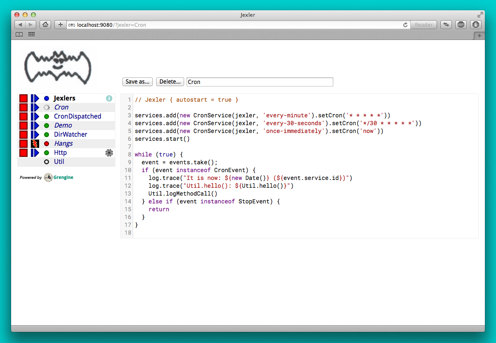

# jexler

<code>Jexler is a simple relaxed Groovy framework for starting/stopping</code>\
<code>Groovy scripts as services and enabling them to react to events</code>\
<code>of their choice - great for prototyping and useful for automating.</code>

* Contains a core library plus a web GUI (WAR).
* Groovy, JDK 8, [Spock](https://spockframework.org) unit tests,
  Gradle, Apache 2.0 License
* Web GUI: Groovy, Servlet 2.5, [CodeMirror](https://codemirror.net)
* [User Guide](guide.md)
  • [Release Notes](releases.md)
  • [Webapp](https://github.com/alainstalder/jexler/releases)
  • [Docker Image](https://hub.docker.com/r/jexler/jexler)
* Build: `./gradlew clean build slowTests`
* Demo: `./gradlew demo` → http://localhost:9090/
* This is vintage software now, no new public releases.

